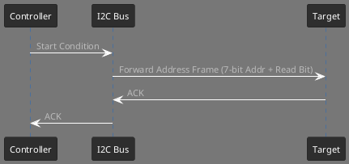

# typeCAD Documentation Generator Usage Guide

The typeCAD Documentation Generator is a tool to convert markdown files into KiCAD documentation with support for layer exports and renders.

See an example here of the Libre Space Foundation [SatNOGS COMMS Hardware](https://typecad.net/packages/typecad-docgen/satnogs/index.html?page=1). We made some very minor changes to the [KiCAD project](https://gitlab.com/librespacefoundation/satnogs-comms/satnogs-comms-hardware) and copied/pasted the information they had on their repo to create this.

You can also read the [usage](https://typecad.net/packages/typecad-docgen/usage/index.html?page=1) guide which was generated with this package.

# Installation

```bash
npm install -g @typecad/typecad-docgen
```

- [KiCAD](https://www.kicad.org/download/) 7.0+ is also required.
- [node/npm.js](https://docs.npmjs.com/downloading-and-installing-node-js-and-npm)

# Basic Usage

```bash
typecad-docgen input.md pcb_file.kicad_pcb
```

This will generate an HTML file with the same name as your input markdown file (e.g., `input.html`).

- All normal markdown is supported
- Pagination is done automatically by putting everything between `#` (h1) in a page
- Layer exports and renders are done with minor markdown syntax additions (see below)
- The output is a single self-contained HTML file with all images inlined (no external image files)
- Responsive design works on desktop and mobile

# Frontmatter Configuration

You can customize the documentation output by adding frontmatter to your markdown file:

```yaml
---
title: My PCB Project
company: Acme Electronics
board_name: Main Controller
variant: release
revision: A
date: 2024-03-30
highlight: github-light
stylesheet: custom.css
kicad_theme: KiCAD Default
dark_mode: false
---
```

# Frontmatter Options

Frontmatter options change themes, stylesheets, and provide information for the navbar.

|        Option |        Description        | Default       |
| ------------: | :-----------------------: | :------------ |
|       `title` |      Document title       | Empty         |
|     `company` |       Company name        | Empty         |
|  `board_name` |      PCB board name       | Empty         |
|     `variant` |       Board variant       | Empty         |
|    `revision` |      Revision number      | Empty         |
|        `date` |       Document date       | Current date  |
|   `highlight` |  Code highlighting theme  | github-light  |
|  `stylesheet` | Custom CSS stylesheet URL | Empty         |
| `kicad_theme` |     KiCad color theme     | KiCAD Default |
|   `dark_mode` |         Dark mode         | false         |

# Generated HTML Features

The output HTML includes:

- **Top navbar** with condensed metadata (company, board name, revision, date)
- **Table of contents** drawer toggled via hamburger menu button
- **Dark/light theme toggle** button in the navbar (also toggled with the `D` key)
- **Scroll snapping** on desktop (sections snap into place); normal scrolling on mobile
- **Responsive tables** that stack vertically as cards on mobile with header labels
- **Inline SVGs** for all layer images (enables CSS variable-based dark mode)
- **Base64 data URIs** for PNG renders
- **Component tooltips** on assembly SVGs (hover over components to see designator, value, footprint)
- **Image zoom modal** with click-to-zoom on any image
- **MathML equations** rendered from AsciiMath and LaTeX
- **Keyboard navigation** (arrow keys, Home/End to navigate sections; D for theme; Escape to close modal/drawer)
- **Accessibility** features (skip link, ARIA labels, live announcements, focus outlines)

# Image Sizing

Image widths can be specified with `=W` or `=WxH` after the image path:

```markdown


```

Percentage widths are also supported:

```markdown

```

- `=550` — 550 pixels wide
- `=550x400` — 550px wide, 400px tall
- `=33%` — 33% of the container width

# Layer Stackup Diagram

To include a PCB layer stackup visualization:

```markdown

```

The information is extracted from the PCB file. It is set in the `PCB Editor, Menu > Board Setup... > Physical Stackup`.

# Layer Exports

To export specific PCB layers, use the following syntax:

```markdown


```

- Layer colors are determined by the KiCAD theme. Any installed KiCAD theme can be used, and is defined in the frontmatter using `kicad_theme`.
- Multiple layers can be combined by separating them with commas. The order they appear in the list matters: the first layer will be on the bottom, the second will be above the first and so on. This allows the layers to show details without being covered by other layers, ie. F.Silkscreen as the last layer will put it on top of all other layers.
- In KiCAD, layers can be renamed, ie `User.2` might be renamed to `Dimension`. KiCAD doesn't recognize the new name, so make sure the original layer name is used in the markdown.
- SVGs are cropped to content bounds and embedded inline for responsive scaling and dark mode support.

# 3D Renders

To include 3D renders of your PCB:

```markdown


```

The render syntax is: `{Render/view/x/y/z}` where:

- `view`: bottom, left, right, front, or back
- `x,y,z`: rotation angles in degrees

The render will use the KiCAD preset view `Follow PCB Editor`. If a layer is not visible in the PCB Editor, that layer will not be rendered. The colors selected in the KiCAD 3D Viewer window will be used as well.

*NOTE: if a particular copper surface finish is selected, the color for it is not automatically selected, it must be selected in the 3D Viewer dialog, ie if HAL is selected, the copper finish will not appear silver until it is manually changed from the default copper/gold color*

# Drill Map

There are two options for drill maps:

1. `` will create a drill map from the PCB file
2. Exporting an SVG or DXF file from KiCAD, then importing it into a layer and exporting it as described above

If you use the {Drill} method, you'll always have an updated map and not have to manually do it. You lose some control over how it appears. KiCAD doesn't generate the images using a theme, so it will always be black/white.

# Custom CSS

You can use a custom CSS stylesheet by adding the `stylesheet` option in the frontmatter. Here's an example:

```css
body.light-mode {
  --color-text: #1a1a1a;              /* Main text color */
  --color-background: #ffffff;        /* Document background color */
  --color-border: #e0e0e0;            /* Border color for elements */
  --color-accent: #0366d6;            /* Accent color for links and highlights */
  --color-image-background: #ffffff;  /* Background color for images */
}

body.dark-mode {
  --color-text: #ffffff;              /* Main text color */
  --color-background: #121212;        /* Document background color */
  --color-border: #333333;            /* Border color for elements */
  --color-accent: #58a6ff;            /* Accent color for links and highlights */
  --color-image-background: #121212;  /* Background color for images */
}
```

Additional CSS variables are available for stackup colors, alert colors, and navbar styling. Inspect the CSS in the browser for the full list.

# UML Diagrams

You can include UML diagrams using PlantUML syntax:

```markdown


A list of themes can be found [here](https://www.plantuml.com/plantuml/uml/SyfFKj2rKt3CoKnELR1Io4ZDoSa700002)

# Code Highlighting

Code blocks are syntax-highlighted:

````cpp
```cpp:optional_name.cpp
void app_main(void)
{
    printf("typecad-docgen");
}
```
````

You can change the theme to any listed here: [https://shiki.style/themes](https://shiki.style/themes).

A filename can be given by adding `:<filename>` to the end of the language name.

# Math

Inline AsciiMath $a^2 + b^2 = c^2$ (`$a^2 + b^2 = c^2$`)
and inline LaTeX math \(\sin \theta\) (`\(\sin \theta\)`) is supported using the backtick character.

AsciiMath blocks:

```
$$
e = sum_(n=0)^oo 1 / n!
$$
```

And LaTeX blocks:

```
\[
e = \sum_{n=0}^{\infty} \frac{1}{n!}
\]
```

# Task Lists

- [x] Task 1
- [ ] Task 2
- [ ] Task 3

```markdown
- [x] Task 1
- [ ] Task 2
- [ ] Task 3
```

# Alerts

Styled alerts/admonitions are available.

```markdown
> [!NOTE]
> Highlights information that users should take into account.

> [!TIP]
> Optional information to help a user.

> [!IMPORTANT]
> Crucial information.

> [!WARNING]
> Critical content demanding immediate user attention.

> [!CAUTION]
> Negative potential consequences of an action.
```

# Programmatic API

The package exports a programmatic API for use in Node.js scripts:

```js
import { generateDocumentation } from '@typecad/typecad-docgen';

await generateDocumentation({
    markdownPath: 'input.md',
    pcbPath: 'board.kicad_pcb',
    outputPath: 'output.html',
    quiet: true,
});
```

# Common Issues

1. **KiCad Not Found**: Ensure KiCad is installed and accessible in your system PATH or in the default installation directory
2. **Image Generation Fails**: Check if you have write permissions in the output directory
3. **Layer Not Found**: Verify the layer name matches exactly with KiCAD layer names, not renamed layers, but the original default names (User.1, User.2, etc.)

# Example Template
```
# Fabrication Notes

|                 Stackup                 |                        Dimensions                         |                Drills                |
| :-------------------------------------: | :-------------------------------------------------------: | :----------------------------------: |
|  |  |  |

1. FABRICATE PER IPC-6012A CLASS 2
2. REFER TO ABOVE IMAGE FOR BOARD THICKNESSES, IMPEDANCE CONTROL, SOLDERMASK AND SURFACE FINISH DETAILS
3. VENDOR SHOULD FOLLOW ROHS COMPLIANT PROCESS AND Pb FREE FOR MANUFACTURING
4. PRINTED CIRCUIT BOARD SHALL COMPLY WITH REQUIREMENTS OF ANSI/J-STD-003
5. FLATNESS REQUIREMENTS: TEST IN ACCORDANCE WITH THE CURRENT REVISION OF IPC-TM-650 2.4.22
6. PCB MATERIAL REQUIREMENTS: Tg 170 C OR EQUIVALENT
7. ALL DIMENSIONS ARE IN MILLIMETERS UNLESS OTHERWISE SPECIFIED

# L1


# L2


_flipped_

# Renders

|                          Top View                          |                        Bottom View                        |
| :--------------------------------------------------------: | :-------------------------------------------------------: |
|  |  |

# Top Assembly

|                              Top View                              |                      Render                       |
| :----------------------------------------------------------------: | :-----------------------------------------------: |
|  |  |

# Bottom Assembly

|                        Bottom View                        |                     Render                      |
| :-------------------------------------------------------: | :---------------------------------------------: |
|  |  |
```

Run 
`typecad-docgen <template.md> <your.kicad_pcb>` and the result will be `template.html` in the same directory.

# License

MIT
