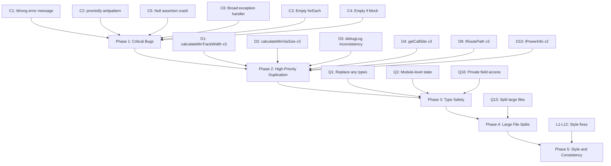

# @typecad/typecad — Prioritized Code Review

> **Scope:** Full static review of `@typecad/typecad` source, routing module, CLI scripts, and root configuration files.
> **Date:** 2026-05-09

---

## Summary

| Severity | Count |
|----------|-------|
| 🔴 Critical (Bugs / Correctness) | 6 |
| 🟠 High (Duplication) | 12 |
| 🟡 Medium (Code Quality) | 26 |
| 🔵 Low (Style / Minor) | 12 |
| **Total** | **56** |

---

## 🔴 CRITICAL — Bugs & Correctness Issues

### C1. Wrong error message in [`component.ts:157`](../@typecad/typecad/src/component.ts:157)

The validation checks a **reference designator pattern** (`/^[A-Za-z]+\d+$/`) but the thrown error says *"Pin number must be a number or a string"*. Users will be misled about what is actually wrong.

**Fix:** Change the error message to describe reference designator validation, e.g. *"Invalid reference designator format: must match {prefix}{number} (e.g. R1, U3)"*.

---

### C2. `promisify(execSync)` antipattern in [`kicad_commands.ts:6`](../@typecad/typecad/src/kicad_commands.ts:6)

```ts
const execAsync = promisify(execSync);
```

`execSync` is synchronous and returns a `Buffer`, not a `Promise`. `promisify` on it is semantically incorrect. While it may appear to work in some Node.js versions due to internal duck-typing, it is not guaranteed behavior and the intent is confusing.

**Fix:** Use `execFile` from `child_process` (which is already promisify-able), or use `exec` (async) instead of `execSync`.

---

### C3. Empty `forEach` loop in [`pcb_board_creation.ts:133-134`](../@typecad/typecad/src/pcb_board_creation.ts:133)

```ts
pcb.components.forEach((comp: Component) => {
    // empty body
});
```

Dead code — iterates over all components doing nothing. This suggests removed functionality that was not cleaned up.

**Fix:** Remove the empty loop entirely.

---

### C4. Empty if block in [`pcb_layer_utils.ts:94-95`](../@typecad/typecad/src/pcb/pcb_layer_utils.ts:94)

An `if` block with an empty body, likely from removed logging statements.

**Fix:** Remove the dead if block.

---

### C5. Non-null assertion on regex match in [`reference_counter.ts:24-25`](../@typecad/typecad/src/reference_counter.ts:24)

```ts
const match = reference.match(regex);
const prefix = match[1].toUpperCase();
const number = parseInt(match[2], 10);
```

Uses `!` (non-null assertion) on regex match results without validation. If the regex doesn't match, this will crash with `Cannot read properties of null`.

**Fix:** Add a null check: `if (!match) return false;`

---

### C6. Overly broad `uncaughtException` handler in [`create-typecad/index.js:8-17`](../@typecad/typecad/cli/create-typecad/index.js:8)

```js
process.on("uncaughtException", (error) => {
  if (
    (error instanceof Error && error.name === "ExitPromptError") ||
    error.name === "Error"
  ) {
    process.exit(0);
  }
});
```

The condition `error.name === "Error"` matches **every** standard `Error` instance, meaning any unhandled error silently exits with code 0. This masks real bugs in production.

**Fix:** Only catch `ExitPromptError` by name, remove the `error.name === "Error"` branch.

---

## 🟠 HIGH — Duplication

### D1. `calculateMinTrackWidth()` in 3 places

All implement the identical IPC-2221 formula:

| Location | Scope |
|----------|-------|
| [`pcb_track_builder.ts:47-75`](../@typecad/typecad/src/pcb/pcb_track_builder.ts:47) | Private method |
| [`pcb_routing_calculations.ts:88-108`](../@typecad/typecad/src/pcb/pcb_routing_calculations.ts:88) | Exported function |
| [`astar_router.ts:33-61`](../@typecad/typecad/src/routing/router/astar_router.ts:33) | Private function |

**Fix:** All three should import from `pcb_routing_calculations.ts` (the canonical exported version).

---

### D2. `calculateMinViaSize()` in 3 places

| Location | Scope |
|----------|-------|
| [`pcb_track_builder.ts:217-260`](../@typecad/typecad/src/pcb/pcb_track_builder.ts:217) | Private method |
| [`pcb_routing_core.ts:245-282`](../@typecad/typecad/src/pcb/pcb_routing_core.ts:245) | Private function |
| [`astar_router.ts:70-113`](../@typecad/typecad/src/routing/router/astar_router.ts:70) | Private function |

**Fix:** Extract to a shared module (e.g. `pcb_routing_calculations.ts`) and import everywhere.

---

### D3. `debugLog()` with inconsistent implementations in 2 places

| Location | Env var check? |
|----------|---------------|
| [`pcb_autoroute.ts:57-64`](../@typecad/typecad/src/pcb/pcb_autoroute.ts:57) | ✅ Checks `process.env.TYPECAD_DEBUG` |
| [`pcb_routing_core.ts:25-29`](../@typecad/typecad/src/pcb/pcb_routing_core.ts:25) | ❌ Only checks `debug` parameter |

This means debug behavior is inconsistent depending on which code path is active.

**Fix:** Create a single `debugLog()` in a shared location that both files import, with consistent env var checking.

---

### D4. `getCallSite()` duplicated in 3 places

| Location | Notes |
|----------|-------|
| [`utils/stack_trace.ts:8-51`](../@typecad/typecad/src/utils/stack_trace.ts:8) | Exported utility — the canonical version |
| [`component.ts:292-328`](../@typecad/typecad/src/component.ts:292) | Private `getCallSiteForInstantiation()` — not using the utility |
| [`pcb_track_builder.ts:169-215`](../@typecad/typecad/src/pcb/pcb_track_builder.ts:169) | Private `getCallSite()` — not using the utility |

**Fix:** Refactor `component.ts` and `pcb_track_builder.ts` to use the shared `getCallSite()` from `utils/stack_trace.ts`.

---

### D5. `logging.js` (root) vs [`logging.ts`](../@typecad/typecad/src/logging.ts) — near-identical

Root `logging.js` exists for scripts outside the TS build (`watch.js`, `bundleDocs.js`). Both implement `debug/info/warn/error` with chalk and env vars.

**Fix:** Consider having the root scripts import from the built `dist/logging.js` instead of maintaining a separate copy, or extract to a shared `logging.core.js`.

---

### D6. Back-side transformation code duplicated in [`pcb_footprint.ts`](../@typecad/typecad/src/pcb/pcb_footprint.ts)

Lines 104-146 and 160-200 have nearly identical flip-Y, add-180°, add-mirror-justify logic for both `property` and `fp_text` handling.

**Fix:** Extract a shared `applyBackSideTransform()` helper function.

---

### D7. Obfuscator config hardcoded in [`watch.js:134-162`](../@typecad/typecad/watch.js:134)

Duplicates `obfuscator.strong.config.json`. Changes to the obfuscator config must be made in two places.

**Fix:** Import/read from `obfuscator.strong.config.json` in `watch.js`.

---

### D8. `IPcbState` vs `IPcbBoardContext` overlap

| Interface | Location |
|-----------|----------|
| `IPcbState` | [`pcb_state.ts:19-38`](../@typecad/typecad/src/pcb/pcb_state.ts:19) |
| `IPcbBoardContext` | [`pcb_board_context.ts:28-168`](../@typecad/typecad/src/pcb/pcb_board_context.ts:28) |

These share many properties (`components`, `tracks`, `outlines`, `zones`, etc.).

**Fix:** Have `IPcbState` extend `IPcbBoardContext` or extract shared properties to a common base interface.

---

### D9. `IRoutePath` interface defined in 3 places

| Location | Differences |
|----------|------------|
| [`pcb_interfaces.ts:575-590`](../@typecad/typecad/src/pcb/pcb_interfaces.ts:575) | Full version with `metadata`, `directives` |
| [`routing/router/types.ts:37-45`](../@typecad/typecad/src/routing/router/types.ts:37) | Adds `gridNodes`, `segments` |
| [`routing/types/length_match.ts:17-20`](../@typecad/typecad/src/routing/types/length_match.ts:17) | Minimal version with just `nodes`, `length` |

**Fix:** Define a single canonical `IRoutePath` and use `Pick`/`Omit`/`extends` for variants.

---

### D10. `IPowerInfo` interface defined in 2 places

| Location |
|----------|
| [`pcb_interfaces.ts:219-223`](../@typecad/typecad/src/pcb/pcb_interfaces.ts:219) |
| [`routing/router/types.ts:8-15`](../@typecad/typecad/src/routing/router/types.ts:8) |

**Fix:** Export from one location and import in the other.

---

### D11. `normalizeNetName()` duplicated in 2 places

| Location |
|----------|
| [`pcb_board_creation.ts:275-281`](../@typecad/typecad/src/pcb/pcb_board_creation.ts:275) |
| [`manual_via_helpers.ts:11-23`](../@typecad/typecad/src/pcb/manual_via_helpers.ts:11) |

**Fix:** Extract to a shared utility (e.g. `pcb_utils.ts`).

---

### D12. `parseArguments()` duplicated across all 3 CLI files

| Location |
|----------|
| [`cli/add-component/index.js:36`](../@typecad/typecad/cli/add-component/index.js:36) |
| [`cli/add-package/index.js:39`](../@typecad/typecad/cli/add-package/index.js:39) |
| [`cli/create-typecad/index.js:21`](../@typecad/typecad/cli/create-typecad/index.js:21) |

**Fix:** Extract a shared `parseArgs()` utility for CLI scripts.

---

## 🟡 MEDIUM — Code Quality

### Q1. Excessive `any` type usage

The following locations lose type safety through `any`:

| File | Line(s) | Description |
|------|---------|-------------|
| [`pcb.ts`](../@typecad/typecad/src/pcb.ts) | class-level | `#existingBoardElements: any[]` |
| [`pcb_autoroute.ts`](../@typecad/typecad/src/pcb/pcb_autoroute.ts) | 185 | `pcb: any` parameter |
| [`pcb_board_creation.ts`](../@typecad/typecad/src/pcb/pcb_board_creation.ts) | multiple | Numerous `any` casts in loops |
| [`pcb_footprint.ts`](../@typecad/typecad/src/pcb/pcb_footprint.ts) | 8, 409, 607 | `subItem: any[]`, `node: any[]` |
| [`pcb_net_resolver.ts`](../@typecad/typecad/src/pcb/pcb_net_resolver.ts) | 40 | `p: any` in find callback |
| [`source_inspector.ts`](../@typecad/typecad/src/source_inspector.ts) | multiple | Heavy `any` + `@ts-ignore` |
| [`routing/types/length_match.ts`](../@typecad/typecad/src/routing/types/length_match.ts) | 23 | `pcb: any` |
| [`routing/router/steiner_optimizer.ts`](../@typecad/typecad/src/routing/router/steiner_optimizer.ts) | 79, 89 | `router?: any` |
| [`routing/shared/obstacle_builder.ts`](../@typecad/typecad/src/routing/shared/obstacle_builder.ts) | 48-49 | `(pcb as any)` casts |
| [`routing/router/segment_worker.ts`](../@typecad/typecad/src/routing/router/segment_worker.ts) | multiple | Dynamic imports typed as `any` |
| [`routing/shared/worker_pool.ts`](../@typecad/typecad/src/routing/shared/worker_pool.ts) | 6-7, 83 | `payload: any`, `result: any` |

**Fix:** Progressively replace `any` with proper interfaces. Priority: `pcb_autoroute.ts` and `pcb_board_creation.ts` which are core paths.

---

### Q2. Module-level mutable state in [`kicad.ts`](../@typecad/typecad/src/kicad.ts)

```ts
export let kicad_path: string | undefined;
export let kicad_cli_path: string | undefined;
export let is_flatpak: boolean = false;
```

These are mutable module-level exports. This makes testing difficult (can't reset between tests) and prevents multiple independent KiCAD configurations.

**Fix:** Encapsulate in a class or factory function with explicit initialization/reset.

---

### Q3. Mixed private field naming in [`component.ts`](../@typecad/typecad/src/component.ts)

- `#footprint_file`, `#symbol_file`, `#isInitialized` — ES private fields (`#`)
- `_uuid`, `_gettingUuid` — Convention-based private (`_`)

**Fix:** Standardize on one approach. Prefer `#` for true privacy, or `_` for consistency with the rest of the PCB codebase.

---

### Q4. Mixed logging approaches

| File | Approach |
|------|----------|
| [`schematic.ts`](../@typecad/typecad/src/schematic.ts) | `process.stdout.write(chalk...)` directly |
| Most other files | `logger` from `src/logging.ts` |
| [`length_matcher.ts`](../@typecad/typecad/src/routing/length_matching/length_matcher.ts) | Local chalk fallback object |

**Fix:** Use the shared `logger` everywhere. Replace `process.stdout.write` calls in `schematic.ts`.

---

### Q5. PascalCase `Components` property in [`schematic.ts`](../@typecad/typecad/src/schematic.ts)

The `Components` getter uses PascalCase while all other collection properties across the codebase use camelCase (`components`, `pins`, `tracks`, etc.).

**Fix:** Rename to `components` (with a deprecation alias for backward compatibility if this is a public API).

---

### Q6. Commented-out code in [`erc.ts:279`](../@typecad/typecad/src/erc.ts:279)

Warning code that was commented out but not removed.

**Fix:** Remove commented-out code or convert to a `// TODO` with explanation.

---

### Q7. Excessive blank lines in [`pcb_footprint.ts:9-12`](../@typecad/typecad/src/pcb/pcb_footprint.ts:9)

Four blank lines at the start of a function body.

**Fix:** Remove excess blank lines.

---

### Q8. `IPower` interface not exported from [`buses.ts`](../@typecad/typecad/src/buses.ts)

The `Power` class constructor takes an `IPower` parameter but the interface is not exported, preventing external consumers from typing their config objects.

**Fix:** Add `export` to the `IPower` interface.

---

### Q9. Redundant property assignments in [`buses.ts:47-82`](../@typecad/typecad/src/buses.ts:47)

The `Power` constructor destructures `powerInfo` (which sets `this.voltage` and `this.current`), then immediately sets them again:

```ts
constructor({ power, gnd, voltage, current, ... }: IPower = {}) {
    // ... powerInfo already sets this.voltage, this.current
    this.voltage = voltage;  // redundant
    this.current = current;  // redundant
}
```

**Fix:** Remove the redundant assignments or restructure the constructor.

---

### Q10. Repetitive switch-case in [`erc_pin_pin`](../@typecad/typecad/src/erc.ts:93)

The `open_collector` (lines 141-154) and `open_emitter` (lines 155-171) cases are nearly identical.

**Fix:** Consolidate into a single case or extract a shared helper.

---

### Q11. Fragile path resolution in [`config.ts`](../@typecad/typecad/src/config.ts)

```ts
const configPath = process.cwd() + '/typecad.json';
```

String concatenation for paths is fragile (no separator normalization). Should use `path.join()` or `path.resolve()`.

**Fix:** Use `path.join(process.cwd(), 'typecad.json')`.

---

### Q12. New `KiCAD()` instance per call in [`component.ts`](../@typecad/typecad/src/component.ts)

[`footprint_lib()`](../@typecad/typecad/src/component.ts:415) and [`symbol_lib()`](../@typecad/typecad/src/component.ts:488) each create a new `KiCAD()` instance on every invocation.

**Fix:** Cache the `KiCAD` instance (lazy singleton pattern).

---

### Q13. Very large files — maintainability concern

Files exceeding 600 lines that should be considered for splitting:

| File | Lines | Suggested Split |
|------|-------|----------------|
| [`grid_search.ts`](../@typecad/typecad/src/routing/router/grid_search.ts) | 2105 | Extract search window logic, occupancy caching |
| [`length_matcher.ts`](../@typecad/typecad/src/routing/length_matching/length_matcher.ts) | 1464 | Extract pattern fitting, segment collection |
| [`pcb_autoroute.ts`](../@typecad/typecad/src/pcb/pcb_autoroute.ts) | 1403 | Extract bounds calculation, grid building |
| [`astar_router.ts`](../@typecad/typecad/src/routing/router/astar_router.ts) | 1226 | Extract power calculations (already duplicated) |
| [`pcb.ts`](../@typecad/typecad/src/pcb/pcb.ts) | 1318 | Extract zone/keepout/graphics delegation |
| [`pcb_board_creation.ts`](../@typecad/typecad/src/pcb/pcb_board_creation.ts) | 1234 | Extract net merging, via processing |
| [`routing_grid.ts`](../@typecad/typecad/src/routing/shared/routing_grid.ts) | 1103 | Extract obstacle rasterization |
| [`pcb_footprint.ts`](../@typecad/typecad/src/pcb/pcb_footprint.ts) | 849 | Extract back-side transform, property handling |
| [`obstacle_builder.ts`](../@typecad/typecad/src/routing/shared/obstacle_builder.ts) | 655 | Extract via/zone/track obstacle builders |
| [`schematic_visualizer.ts`](../@typecad/typecad/src/schematic_visualizer.ts) | 633 | Extract symbol library manager |
| [`schematic.ts`](../@typecad/typecad/src/schematic.ts) | 632 | Extract BOM generation, project tree |
| [`pcb_interfaces.ts`](../@typecad/typecad/src/pcb/pcb_interfaces.ts) | 639 | Split into domain-specific interface files |
| [`profiler.ts`](../@typecad/typecad/src/routing/shared/profiler.ts) | 799 | Extract baseline/regression logic |

**Fix:** Plan incremental file splits, prioritizing the largest files first.

---

### Q14. `Profiler` singleton may be over-engineered

At 799 lines, the [`profiler.ts`](../@typecad/typecad/src/routing/shared/profiler.ts) includes memory tracking, hierarchical profiling, performance alerts, hotspot detection, regression detection, and baseline management. This is substantial complexity for a development/debug tool.

**Fix:** Consider whether all features are actively used. If not, simplify to the core timing functionality.

---

### Q15. `SimpleRoutingGrid` doesn't fully match [`IRoutingGrid`](../@typecad/typecad/src/routing/contracts/routing_grid.ts) contract

The `isOccupied` method signature in `SimpleRoutingGrid` differs from the `IRoutingGrid` interface (different parameter names/order).

**Fix:** Align `SimpleRoutingGrid.isOccupied()` with the `IRoutingGrid` contract.

---

### Q16. `ObstacleBuilder` accesses private fields via `any` casts

[`obstacle_builder.ts:48-49`](../@typecad/typecad/src/routing/shared/obstacle_builder.ts:48) uses `(pcb as any)._getComponents?.()` and `(pcb as any)['#components']` to access private state. The comment explains this is necessary because `IPcbBoardContext` getters return empty arrays during routing.

**Fix:** Add routing-phase-aware accessors to `IPcbBoardContext` or `PCB` class that return the correct data during routing.

---

### Q17. `pcb_kicad_window.ts` is Windows-only

Uses PowerShell commands directly, making it non-portable to macOS/Linux.

**Fix:** Add platform detection and provide fallback implementations for macOS/Linux (e.g., using `wmctrl` or AppleScript).

---

### Q18. `segment_worker.ts` has misleading comments

Comments mention `require()` but the code actually uses dynamic `import()`.

**Fix:** Update comments to reflect actual implementation.

---

### Q19. `@ts-ignore` suppressions in [`source_inspector.ts`](../@typecad/typecad/src/source_inspector.ts)

Multiple `@ts-ignore` comments suppress type errors instead of properly typing the AST walker.

**Fix:** Define proper types for AST node visitors or use type guards.

---

### Q20. `eslint-disable` in [`length_matcher.ts:29`](../@typecad/typecad/src/routing/length_matching/length_matcher.ts)

```ts
// eslint-disable-next-line no-undef
const envDbg = typeof process !== 'undefined' && ...
```

**Fix:** Configure ESLint to recognize `process` as a global, or use a type-safe check.

---

### Q21. Inconsistent JSDoc coverage

Some files have extensive JSDoc (e.g., `pcb_graphics.ts`, `pcb_zones.ts`, `pad_resolver.ts`) while others have minimal or none (e.g., `buses.ts`, `config.ts`, CLI files).

**Fix:** Establish a minimum documentation standard for public APIs.

---

### Q22. `IRoutingGrid` contract vs `RoutingGrid` implementation mismatch

The [`IRoutingGrid`](../@typecad/typecad/src/routing/contracts/routing_grid.ts:15) interface defines `isOccupied()` with parameters `clearance`, `net`, `considerObstacleClearance`, `sumObstacleClearance`, but the actual [`RoutingGrid`](../@typecad/typecad/src/routing/shared/routing_grid.ts:134) class has a different signature.

**Fix:** Align the contract with the implementation or vice versa.

---

### Q23. `pcb_autoroute_batch.ts` uses `as any` casts for route options

Line 80: `pcb.route({ ...(adjusted as IAutorouteOptions), from: item.from as any, to: item.to as any })`

**Fix:** Define a proper type that combines `IAutorouteOptions` with `from`/`to` fields.

---

### Q24. `pcb_autoroute.ts` `collectPadSummariesForRouting` returns loosely typed data

The function at line 153 returns arrays with `any` element types.

**Fix:** Define a `IPadSummary` interface.

---

### Q25. `pcb_board_creation.ts` complex net merging logic

The net merging logic spanning lines 225-380 is extremely complex with nested loops, multiple normalization passes, and edge cases. This is difficult to test and maintain.

**Fix:** Extract into a dedicated `NetMerger` class with clear input/output contracts and unit tests.

---

### Q26. `worker_pool.ts` uses `undefined as any` for terminated workers

Line 33: `this.workers[idx] = undefined as any;`

**Fix:** Use `Worker | null` type for the array and check for null.

---

## 🔵 LOW — Style & Minor Issues

### L1. Unused `swap()` method in [`priority_queue.ts:74-78`](../@typecad/typecad/src/routing/shared/priority_queue.ts:74)

The `swap` method is defined but never called — `siftUp` and `siftDown` do inline swaps.

**Fix:** Remove the dead method.

---

### L2. Deprecated `substr()` usage

| File | Line |
|------|------|
| [`length_matcher.ts`](../@typecad/typecad/src/routing/length_matching/length_matcher.ts) | 142 |
| [`routing_grid.ts`](../@typecad/typecad/src/routing/shared/routing_grid.ts) | 194 |

`substr` is deprecated in the ECMAScript spec. Use `substring()` or `slice()` instead.

**Fix:** Replace `substr` with `substring` or `slice`.

---

### L3. `var` usage in [`cli/add-package/index.js`](../@typecad/typecad/cli/add-package/index.js)

Lines 21-26 use `var` instead of `let`/`const`.

**Fix:** Replace with `let`/`const`.

---

### L4. Module-level mutable state in CLI files

[`cli/add-package/index.js:21-26`](../@typecad/typecad/cli/add-package/index.js:21) uses module-level `var` declarations as mutable state.

**Fix:** Encapsulate in a function or class scope.

---

### L5. `create-typecad/index.js` catches all `Error` instances

See C6 above — the `error.name === "Error"` branch is overly broad.

---

### L6. `pcb_kicad_window.ts` — non-portable PowerShell dependency

Already noted in Q17. Additionally, the em dash character (`—`) in window title parsing may not work correctly across all locales.

---

### L7. Inconsistent quote style

Some files use single quotes, others double quotes. The `.prettierrc` should enforce consistency.

**Fix:** Run Prettier across the codebase.

---

### L8. BOM character in [`mst.ts:1`](../@typecad/typecad/src/routing/shared/mst.ts:1)

The file starts with a UTF-8 BOM (`\uFEFF`), which can cause issues with some tools.

**Fix:** Remove the BOM character.

---

### L9. `pcb_autoroute.ts` `enqueueAutoroute` is a narrow utility

The `enqueueAutoroute` function at line 27 is a simple concurrency limiter. Consider using a general-purpose library function.

---

### L10. `sexpr_instance.ts` is a 5-line module

Creates and exports a singleton `SExpr` instance. Could be inlined where needed.

---

### L11. `sexpr_formatter.ts` `maxIndent` hardcoded to 100

The `prettyPrintSExpr` function caps indentation at 100 levels. Deeply nested S-expressions will have incorrect indentation beyond this point.

**Fix:** Make it dynamic or increase the limit.

---

### L12. `debug_visualizer.ts` `ISteinerPoint` redefines interface

[`debug_visualizer.ts:7-11`](../@typecad/typecad/src/routing/utils/debug_visualizer.ts:7) defines its own `ISteinerPoint` interface instead of importing from `steiner_optimizer.ts`.

**Fix:** Import the canonical interface.

---

## Recommended Fix Priority



### Phase 1 — Critical Bugs (Immediate)
Fix C1, C2, C5, C6 first as they affect correctness and user experience.

### Phase 2 — High-Priority Duplication (Next Sprint)
Address D1-D4 to eliminate the most impactful code duplication. This reduces the surface area for future bugs.

### Phase 3 — Type Safety (Ongoing)
Systematically replace `any` types (Q1) starting with the most critical paths: `pcb_autoroute.ts`, `pcb_board_creation.ts`, and `pcb_footprint.ts`.

### Phase 4 — Large File Splits (Planned Refactoring)
Split the 13 files exceeding 600 lines (Q13) incrementally, starting with `grid_search.ts` (2105 lines) and `pcb_autoroute.ts` (1403 lines).

### Phase 5 — Style and Consistency (Continuous)
Address low-priority items (L1-L12) as part of regular maintenance, enforced by linting rules.
