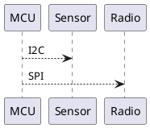

# DocGen

The `typecad-pcb doc` command generates self-contained HTML documentation from a Markdown file and a KiCAD PCB file. It automatically exports PCB layers as inline SVGs and supports rich formatting.

## Usage

```bash
typecad-pcb doc docs/board.md build/board.kicad_pcb -o output.html
```

### Options

| Option | Description |
|--------|-------------|
| `-o ` | Output HTML file path |
| `-v` | Verbose output |
| `-q` | Quiet mode (suppress output) |
| `--no-open` | Don't open the file after generation |

## Markdown Features

DocGen supports standard Markdown plus several extensions:

### Code Highlighting

Syntax highlighting powered by Shiki. Add a filename with `lang:filename` syntax:

````markdown
```typescript:index.ts
let r1 = new Resistor({ value: '1kohm' });
```
````

### PCB Layer Exports

Embed PCB layers directly in your Markdown using `{layers}` in image alt text:

```text

```

This exports the `F.Cu`, `F.SilkS`, and `F.Mask` layers as an inline SVG, sized to 600px wide and merged together in the order they are listed. Use `=50%` for percentage-based sizing, or `=600x400` to set both width and height.

### 3D Renders

Include 3D renders of the board:

```markdown


```

Parameters are: `{Render/side/rotation_x/rotation_y/rotation_z}`. `side` can be `top` or `bottom`.

### Drill Maps and Layer Stackups

```markdown


```

### GitHub Alerts

Styled callout blocks for notes, tips, warnings, important messages, and cautions:

```markdown
> [!NOTE]
> This is a note.

> [!TIP]
> This is a helpful tip.

> [!IMPORTANT]
> Critical information here.

> [!WARNING]
> Something to be careful about.

> [!CAUTION]
> Proceed at your own risk.
```

### Math

Both inline and block math using `$` for AsciiMath and `$$` for LaTeX:

```markdown
The impedance is $Z = sqrt(R^2 + (w L - 1/(w C))^2)$.

$$
P = V \times I = I^2 R = \frac{V^2}{R}
$$
```

### UML Diagrams

Embed PlantUML diagrams directly in your Markdown:

````markdown

````

### Task Lists

Checkbox-style lists that render as interactive toggles:

```markdown
- [x] Schematic review complete
- [x] ERC passed
- [ ] Layout review
- [ ] DRC clean
```

### Multi-row Tables

Extended table support with multiline cells, row spanning, and multiple bodies:

```markdown
| Reference | Value  | Footprint | Description        |
|-----------|--------|-----------|--------------------|
| U1        | 328P   | TQFP-32   | Main MCU \\        |
|           |        |           | ATmega series      |
| R1        | 10k    | 0603      | Pull-up            |
| R2        | 4.7k   ||          | Pull-down          |
|-----------|--------|-----------|--------------------|
| C1        | 100nF  | 0603      | Decoupling         |
| C2        | 10uF   | 0805      | Bulk cap           |
```

A trailing `\` continues a cell onto the next line. An empty `||` merges a cell with the one above it. A second separator row (`|---|`) splits the table into multiple bodies.

### Custom Attributes

Add HTML-like attributes to elements using `{...}` syntax:

```markdown
# Board Layout {.custom-heading}

This paragraph has a CSS class. { .important }

{.bordered .shadow}
```

## Frontmatter

Configure the document using YAML frontmatter:

```yaml
---
title: My Board Documentation
company: Acme Corp
board_name: SensorBoard
variant: Rev A
revision: "1.0"
date: 2026-01-15
highlight_theme: github-dark
stylesheet: custom.css
kicad_theme: Monokai
dark_mode: true
---
```

## Programmatic API

You can also use docgen programmatically:

```ts
import { generateDocumentation } from '@typecad/pcb/docgen';

await generateDocumentation('input.md', 'board.kicad_pcb', 'output.html', {
  verbose: true,
});
```